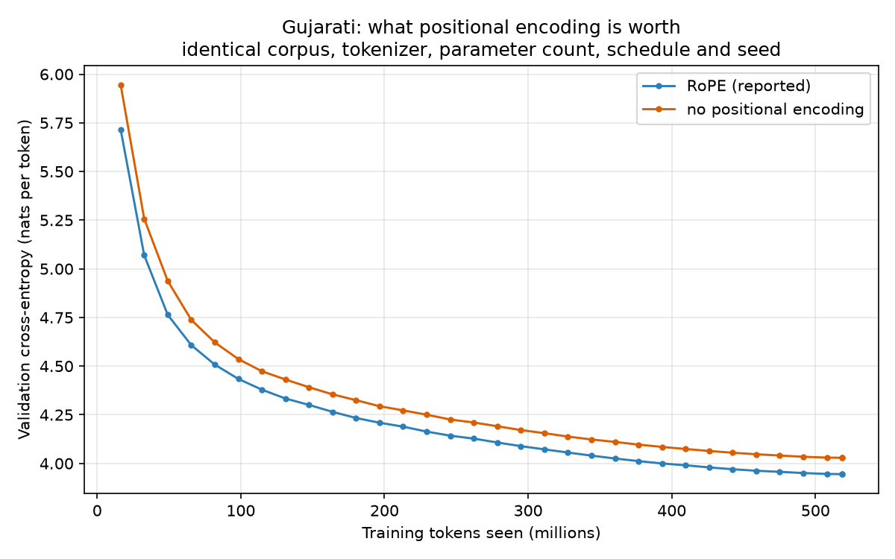
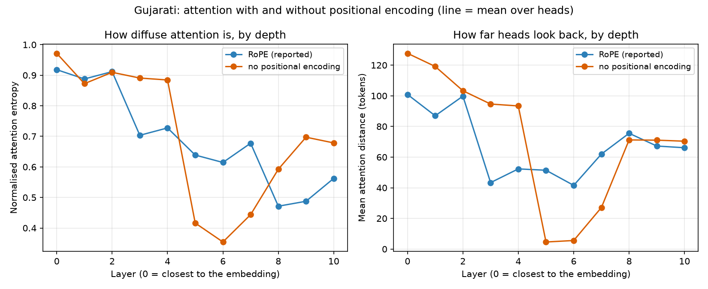

# Phase 2 bonus - ablation: no positional embeddings

Generated by `report/phase2/make_ablation_comparison.py` from the JSON each
evaluation script wrote. Do not edit by hand - re-run the script instead.

The brief's optional bonus: retrain one language with positional information removed and compare it against the standard model. This is Gujarati, 16k vocabulary.

## 0. What the bonus asks for

| The bonus asks for | Where it is |
|---|---|
| Retrain with positional embeddings removed | `logs/config.json` - `positional: none`, same seed and hyperparameters |
| Perplexity / BPB | Section 2, from `json/perplexity.json` |
| BLEU / chrF++ / ROUGE-L | Section 3, from `json/generation.json` |
| Diversity diagnostics | Section 3, Distinct-2 and Repetition-4 |
| Attention heatmaps | `figures/attention_layer0.png`, `attention_layer10.png` |
| Attention entropy / distance | Section 4, plus `figures/attention_entropy.png`, `figures/attention_distance.png` |
| Compare to the standard model | every table here is RoPE against no-position |
| Document the setup | Section 1 |
| Explain what breaks | Section 5 and Section 6 |

## 1. What differs, and what does not

The two runs share the corpus, the tokenizer, the schedule, the batch size
and the seed. RoPE is computed from the position rather than learned, so
removing it changes the parameter count by **zero** - both models have
25,625,856 trainable parameters. `positional: none` in `configs/model.yaml`
is the only difference between them.

| | RoPE | No position |
|---|---:|---:|
| Optimizer steps | 15,826 | 15,826 |
| Training tokens | 518,586,368 | 518,586,368 |
| Wall-clock hours | 4.57 | 4.64 |
| Best validation loss | 3.9450 | 4.0290 |

## 2. Language modelling

| Metric (test split) | RoPE | No position | Change |
|---|---:|---:|---:|
| Cross-entropy (nats/token) | 3.9439 | 4.0266 | +2.1% |
| **Perplexity** | **51.62** | **56.07** | +8.6% |
| **Bits per byte** | **0.5764** | **0.5885** | +2.1% |

## 3. Generation quality

| Decoding | Metric | RoPE | No position | Change |
|---|---|---:|---:|---:|
| greedy | BLEU-4 | 2.68 | 2.33 | -13.2% |
| greedy | chrF++ | 16.00 | 15.19 | -5.1% |
| greedy | ROUGE-L | 12.56 | 11.85 | -5.7% |
| greedy | Distinct-2 | 0.199 | 0.175 | -12.0% |
| greedy | Repetition-4 | 0.703 | 0.744 | +5.8% |
| temp 0.5 | BLEU-4 | 3.27 | 3.29 | +0.5% |
| temp 0.5 | chrF++ | 19.52 | 18.78 | -3.8% |
| temp 0.5 | ROUGE-L | 14.31 | 14.30 | -0.1% |
| temp 0.5 | Distinct-2 | 0.456 | 0.402 | -11.8% |
| temp 0.5 | Repetition-4 | 0.263 | 0.360 | +36.6% |
| temp 1.0 | BLEU-4 | 1.78 | 1.42 | -20.4% |
| temp 1.0 | chrF++ | 20.13 | 19.67 | -2.3% |
| temp 1.0 | ROUGE-L | 11.66 | 11.37 | -2.5% |
| temp 1.0 | Distinct-2 | 0.856 | 0.852 | -0.5% |
| temp 1.0 | Repetition-4 | 0.003 | 0.002 | -43.6% |
| temp 1.5 | BLEU-4 | 0.25 | 0.14 | -43.7% |
| temp 1.5 | chrF++ | 16.23 | 16.57 | +2.1% |
| temp 1.5 | ROUGE-L | 4.79 | 4.92 | +2.8% |
| temp 1.5 | Distinct-2 | 0.982 | 0.979 | -0.3% |
| temp 1.5 | Repetition-4 | 0.003 | 0.003 | -6.3% |

## 4. Attention

| Metric | RoPE | No position | Change |
|---|---:|---:|---:|
| Mean normalised entropy | 0.691 | 0.701 | +1.5% |
| Mean attention distance (tokens) | 67.9 | 71.6 | +5.5% |
| Mean previous-token mass | 0.090 | 0.079 | -11.2% |
| Mean start-token (sink) mass | 0.059 | 0.031 | -47.7% |

## 5. What breaks without position

- Removing positional encoding costs +8.6% test perplexity (51.62 to 56.07) and +2.1% bits-per-byte (0.5764 to 0.5885). Both runs share a tokenizer, so unlike the vocabulary ablation the perplexity comparison is valid on its own here.
- The ablated model still learns. A decoder-only model is not fully permutation invariant even without positional encoding, because the causal mask already carries position: the query at index 0 can attend to one key, the query at index 5 to six. That residual signal is what the ablated model is left with, and it is why the loss falls at all rather than flattening at the unigram entropy.
- At temp 1.0, chrF++ moves from 20.13 to 19.67 (-2.3%). chrF++ is character-level on the decoded text, so it is directly comparable.
- At greedy, chrF++ moves from 16.00 to 15.19 (-5.1%). chrF++ is character-level on the decoded text, so it is directly comparable.
- Attention reorganises rather than degrades. Mean attention distance rises from 67.9 to 71.6 tokens and mean normalised entropy from 0.691 to 0.701: most heads become more diffuse, because without position they cannot specialise on a relative offset.
- But the one positional relation the causal mask still permits - "the token immediately before me" - is held *harder*. The sharpest previous-token head goes from L6H0 at 0.580 (mean distance 12.0 tokens) under RoPE to L7H3 at 0.879 (mean distance 2.3 tokens) without it, and the most local head in the model tightens from 12.0 to 1.2 tokens. The ablated model concentrates its remaining positional capacity into a few very sharp adjacency heads instead of spreading offset specialisation across many.
- Start-token (sink) mass falls from 0.059 to 0.031, -48%. With no positional signal to anchor it, the start token is no longer a distinctive place to park attention that has nothing to contribute.
- The clearest practical symptom is looping. Under greedy decoding repetition-4 rises from 0.703 to 0.744 and Distinct-2 falls from 0.199 to 0.175: a model that cannot tell where it is in the sequence is worse at noticing it has already said something.

## 6. What this tells us

- **The two headline numbers are one fact, not two.** Perplexity rises 8.6% but bits-per-byte only 2.1%. Both come from the same +0.083 nats per token. Perplexity is the *exponential* of cross-entropy, so it magnifies a small change; bits-per-byte is cross-entropy rescaled, so it does not. The honest size of the effect is the 0.083 nats - a small but real loss.
- **The gap stops growing.** Early in training the ablated model is 0.130 nats behind; by the end it is 0.084 nats behind. It falls behind quickly, then holds a steady distance rather than drifting further away. Losing position is a fixed handicap, not a failure that compounds as training goes on.
- **Why it does not collapse.** A causal mask is itself a positional signal: the first token can attend to one key, the sixth to six. That tells the model roughly how far into the sentence it is, even with no positional encoding at all, which is why the ablated model still learns Gujarati rather than producing a bag of words.
- **What position is actually buying.** Not raw word knowledge - the two models are close on that. What RoPE buys is knowing *which* nearby token is which. The ablated model tries to recover this with one very sharp adjacency head, but one head cannot replace a relative-distance signal available to every head at every layer.
- **Sampling hides the damage; greedy exposes it.** At temperature 1.0 chrF++ barely moves (20.13 to 19.67), because randomness breaks loops for free. Under greedy decoding, where the model must rely on its own sense of where it is, repetition rises from 0.703 to 0.744. If you judge this model only by sampled text you would barely notice position was gone.
- **Was RoPE worth it?** Yes, and cheaply. It costs zero parameters and no measurable training time, and buys back the whole gap. Nothing else in this project improves the model for free.
