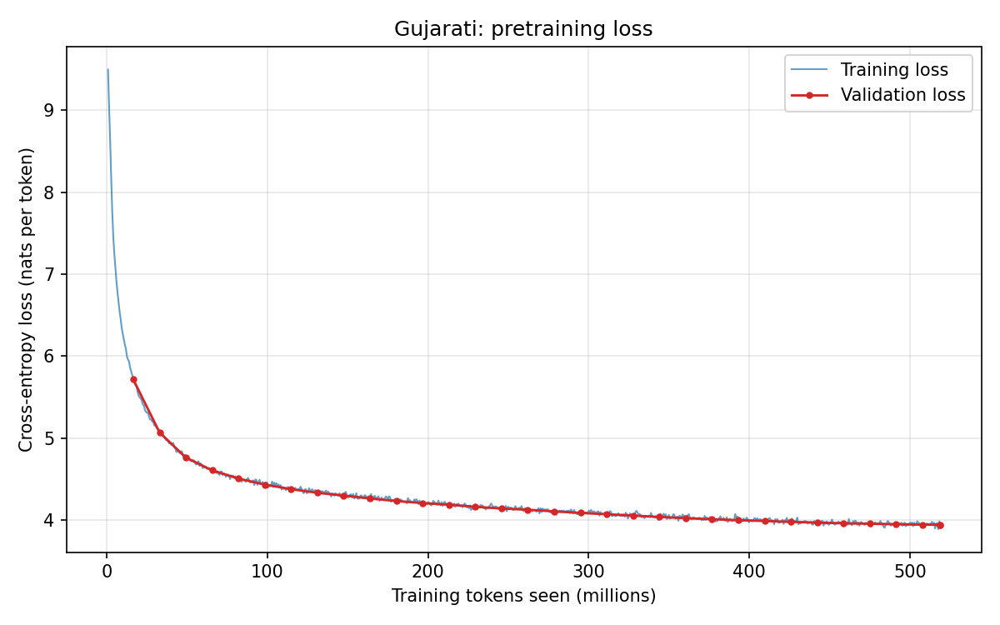
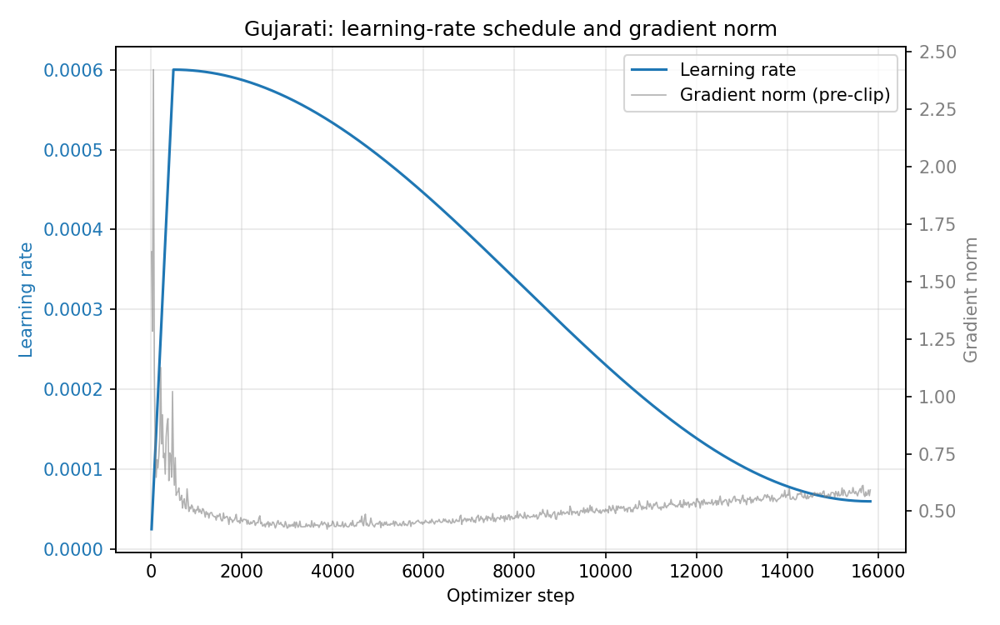
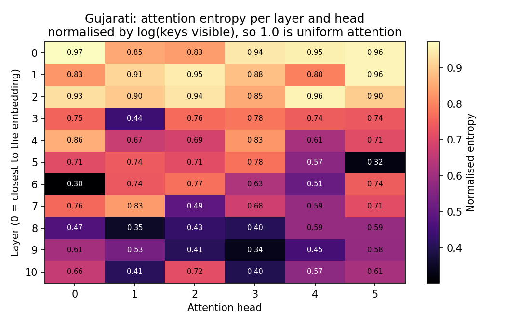
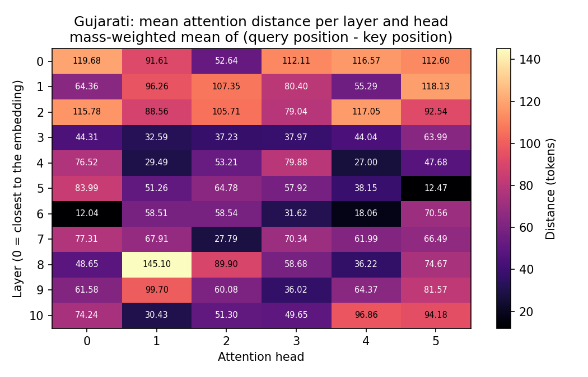
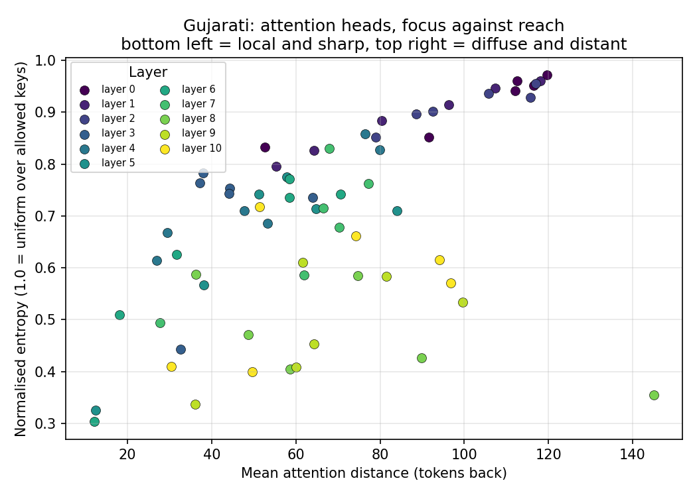
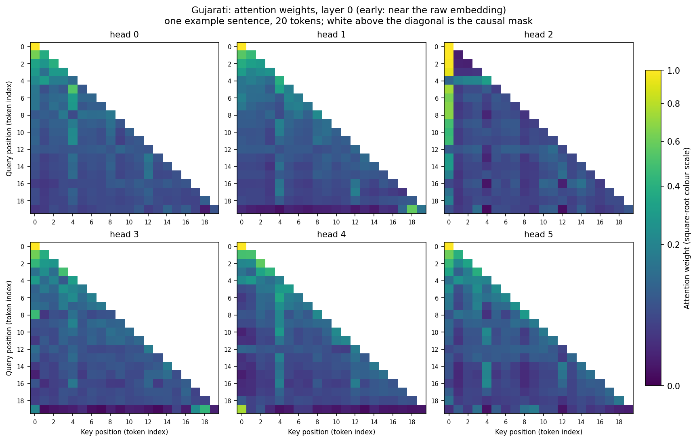
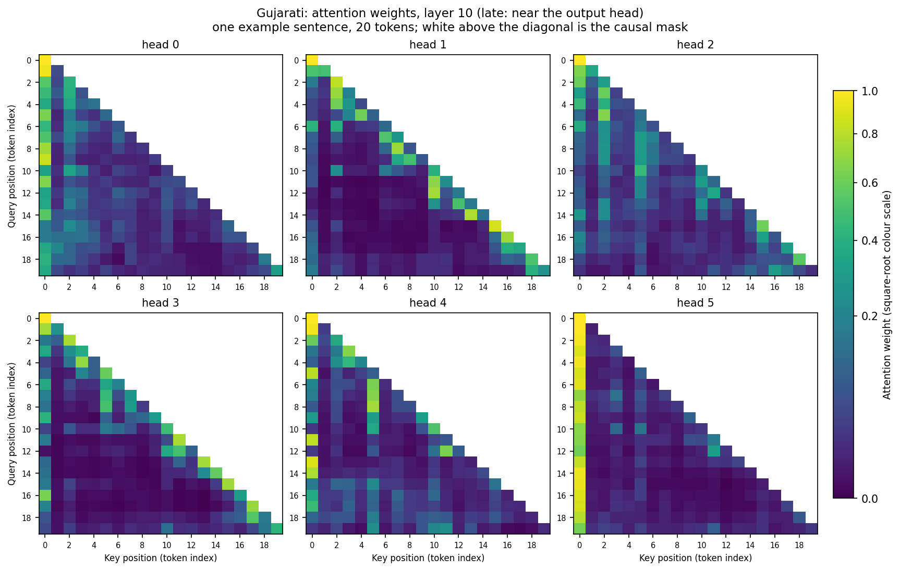
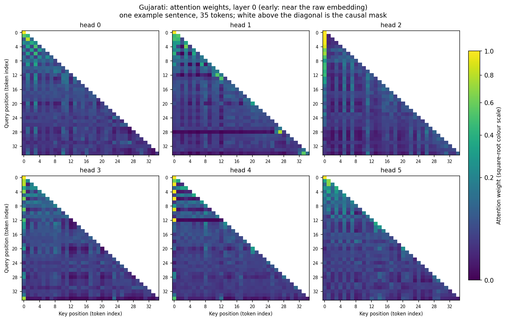
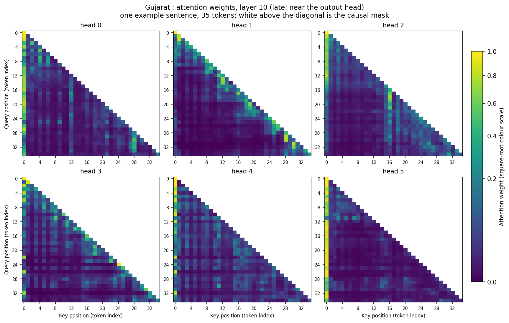

# Gujarati (Model H) - Phase 2 figures, 16k vocabulary

11 layers, 384 wide, 6 heads, vocabulary 16,000. All measured numbers for this model are in [`results.md`](../../results.md); this page is the figures.

### Training and validation loss

Validation is measured every 500 steps on held-out text.

### Learning-rate schedule

Linear warmup over 500 steps, then cosine decay to 10% of peak.

### Attention entropy per head and layer

Normalised by log(keys visible), so 1.0 is uniform attention at any depth. Low rows are focused heads.

### Mean attention distance per head and layer

Mass-weighted mean of (query position - key position). Separates local heads from heads that gather across the prefix.

### Per-head profile

Every head placed by entropy against distance, which is where local, diffuse and long-range heads separate.

### Attention heatmaps

One early layer and one late layer, all heads, on example sentences in this model's language. Axes are token indices; the sentences and their numbered pieces are in [`attention_examples.md`](attention_examples.md).

## Raw results

`json/` holds the output of each evaluation stage: `perplexity.json`, `generation.json`, `attention.json` (per-head entropy and distance grids), `causal_check.json` and `training.json`. Sample continuations are in [`samples.md`](samples.md).
