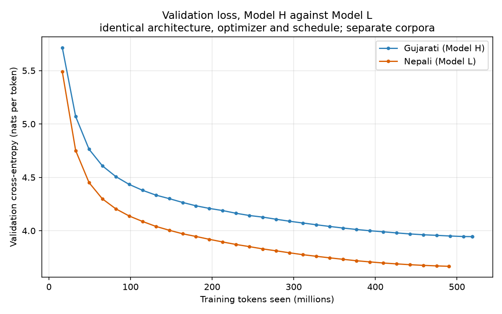
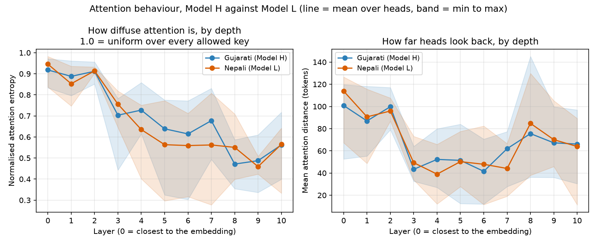

# Phase 2 results

Generated by `report/phase2/make_report_assets.py` from the JSON each
evaluation script wrote. Do not edit by hand - re-run the script instead.

The narrative and the design decisions are in [`README.md`](README.md); this page is the numbers.

## 1. Architecture and parameter count

| | Gujarati (Model H) | Nepali (Model L) |
|---|---:|---:|
| Model dimension | 384 | 384 |
| Layers | 11 | 11 |
| Attention heads | 6 | 6 |
| Head dimension | 64 | 64 |
| Feed-forward width | 1,024 | 1,024 |
| Feed-forward | swiglu | swiglu |
| Context length | 512 | 512 |
| Positional scheme | rope | rope |
| Tied embeddings | yes | yes |
| Dropout | 0.0 | 0.0 |
| Vocabulary | 16,000 | 16,000 |
| **Parameters (total)** | **25,625,856** | **25,625,856** |
| **Parameters (non-embedding)** | **19,481,856** | **19,481,856** |

Both models are the same network. The vocabularies are separate and were
built independently in Phase 1, and the two sweeps ranked the candidate
sizes the same way, so both models use 16k pieces and the parameter
counts match as well. A 12,000-piece vocabulary was also trained at the
same parameter budget as a control; the two are compared in
[`vocab_comparison.md`](vocab_comparison.md).

## 2. Pretraining

| | Gujarati (Model H) | Nepali (Model L) |
|---|---:|---:|
| Optimizer steps | 15,826 | 14,962 |
| Training tokens seen | 518,586,368 | 490,274,816 |
| Wall-clock hours | 4.57 | 4.51 |
| Median throughput (tokens/s) | 31,738 | 30,497 |
| Final training loss | 3.9837 | 3.6508 |
| Best validation loss | 3.9450 | 3.6667 |
| Best validation perplexity | 51.68 | 39.12 |
| Step of best checkpoint | 15,826 | 14,962 |

Per-model loss, perplexity and learning-rate curves are in each
language's own page.

## 3. Language modelling

| Split | Metric | Gujarati (Model H) | Nepali (Model L) |
|---|---|---:|---:|
| validation | Cross-entropy (nats/token) | 3.9611 | 3.6535 |
| validation | Perplexity | 52.52 | 38.61 |
| validation | **Bits per byte** | **0.5826** | **0.4228** |
| validation | Tokens predicted | 28,498,944 | 26,937,856 |
| test | Cross-entropy (nats/token) | 3.9439 | 3.6618 |
| test | Perplexity | 51.62 | 38.93 |
| test | **Bits per byte** | **0.5764** | **0.4247** |
| test | Tokens predicted | 28,225,024 | 27,222,016 |

## 4. Generation quality

| Model | Decoding | BLEU-4 | chrF++ | ROUGE-L | Distinct-1 | Distinct-2 | Repetition-4 |
|---|---|---:|---:|---:|---:|---:|---:|
| Gujarati (Model H) | greedy | 2.68 | 16.00 | 12.56 | 0.102 | 0.199 | 0.703 |
| Gujarati (Model H) | temp 0.5 | 3.27 | 19.52 | 14.31 | 0.190 | 0.456 | 0.263 |
| Gujarati (Model H) | temp 1.0 | 1.78 | 20.13 | 11.66 | 0.428 | 0.856 | 0.003 |
| Gujarati (Model H) | temp 1.5 | 0.25 | 16.23 | 4.79 | 0.614 | 0.982 | 0.003 |
| Gujarati (Model H) | _held-out reference_ | - | - | - | 0.394 | 0.824 | 0.007 |
| Nepali (Model L) | greedy | 1.91 | 15.82 | 11.66 | 0.110 | 0.212 | 0.631 |
| Nepali (Model L) | temp 0.5 | 2.31 | 19.36 | 13.17 | 0.222 | 0.533 | 0.176 |
| Nepali (Model L) | temp 1.0 | 1.41 | 21.02 | 10.38 | 0.424 | 0.882 | 0.001 |
| Nepali (Model L) | temp 1.5 | 0.08 | 17.37 | 4.10 | 0.611 | 0.982 | 0.003 |
| Nepali (Model L) | _held-out reference_ | - | - | - | 0.393 | 0.862 | 0.006 |

Sample continuations: [Gujarati](gujarati/gujarati_16k/samples.md) - [Nepali](nepali/nepali_16k/samples.md).

## 5. Attention

| | Gujarati (Model H) | Nepali (Model L) |
|---|---:|---:|
| Layers x heads | 11 x 6 | 11 x 6 |
| Mean normalised entropy | 0.691 | 0.669 |
| Most diffuse layer | L0 (0.918) | L0 (0.946) |
| Most focused layer | L8 (0.471) | L9 (0.459) |
| Mean attention distance (tokens) | 67.9 | 68.2 |
| Longest-range layer | L0 (100.9) | L0 (113.9) |
| Most local layer | L6 (41.6) | L4 (39.0) |
| Mean previous-token mass | 0.090 | 0.092 |

Heatmaps and the per-head grids are in each language's own page.

## 6. Causal masking

| Check | Gujarati | Nepali |
|---|---:|---:|
| Future edit moves earlier logits by | 0.0e+00 PASS | 0.0e+00 PASS |
| Prefix vs full-sequence logits differ by | 0.0e+00 PASS | 0.0e+00 PASS |
| Largest weight above the diagonal | 0.0e+00 PASS | 0.0e+00 PASS |
| Gradient reaching future positions | 0.0e+00 PASS | 0.0e+00 PASS |

All four checks are described in `eval/causal_check.py`.

## 7. What the numbers say

- On the test split Nepali's perplexity is -24.6% relative to Gujarati's and its bits-per-byte is -26.3%. The two point the same way, which is the stronger result: a Nepali token carries 1.26x as many bytes as a Gujarati one, so Nepali is making the harder prediction at each step and still wins on both measures. Bits-per-byte is the comparable number, and Nepali is ahead on it.
- Model H saw 518.6M training tokens and Model L 490.3M, a 5.5% difference. Everything else about the two runs - architecture, optimizer, schedule, batch size, seed - is identical, so the corpus and the tokenizer are the only variables.
- Model H having the *worse* bits-per-byte while seeing more tokens points at the corpora, not the models - the two networks, optimizers, schedules and seeds are identical. Phase 1 measured the difference: 8.7% of the Gujarati training split is archive.org OCR of books, compressing at 2.77 characters per token against 3.97 for its other manual sources, while the Nepali split has no comparable source and is 78.4% one homogeneous public corpus. Model H is predicting a more varied and noisier distribution.
- Gujarati (Model H) scores highest on chrF++ at **temp 1.0** (20.13), against a reference Distinct-2 of 0.824 and a generated Distinct-2 of 0.856.
- Nepali (Model L) scores highest on chrF++ at **temp 1.0** (21.02), against a reference Distinct-2 of 0.862 and a generated Distinct-2 of 0.882.
