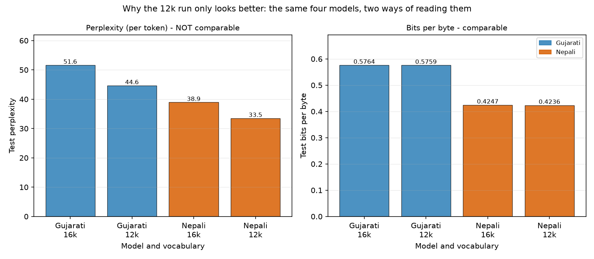
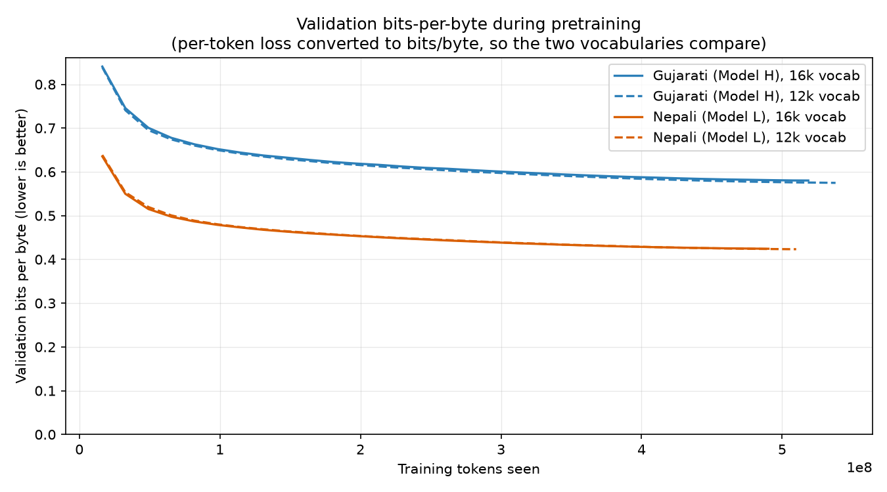
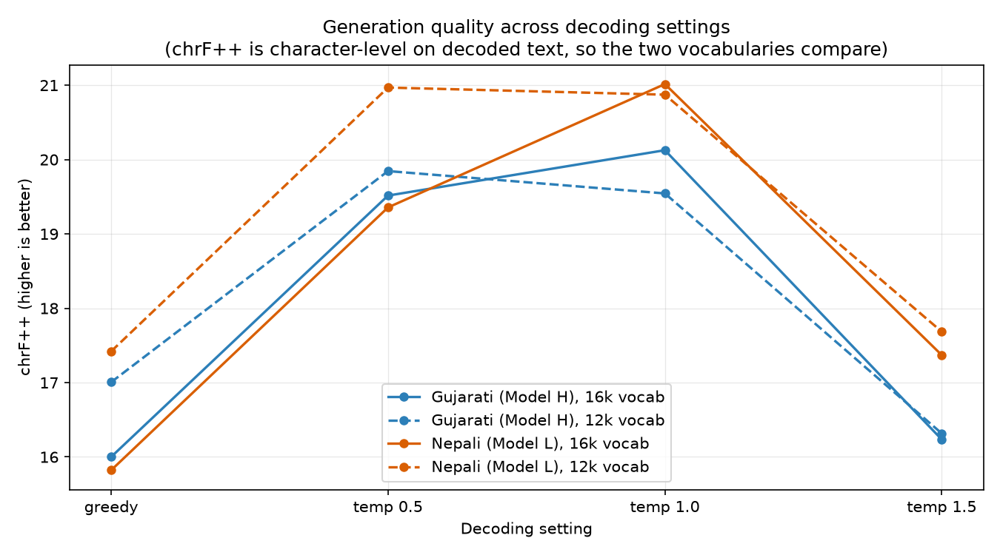

# Phase 2 - vocabulary ablation: 16k vs 12k

Generated by `report/phase2/make_vocab_comparison.py` from the JSON each
evaluation script wrote. Do not edit by hand - re-run the script instead.

Phase 1 selected a 16,000-piece vocabulary from a sweep whose runner-up
was 12,000. Phase 2 trains both, for both languages, at the same 25.6M
parameter budget: the smaller embedding frees 1.54M parameters and that
buys a twelfth Transformer block, so vocabulary size is the only
variable and depth is what absorbs it. Four runs, one epoch each, same
optimizer, same schedule, same seed, same corpus.

The reported 16k models are documented in [`results.md`](results.md); the 12k control run is reported here only.

## 1. How to read this comparison

**Perplexity is not comparable between these runs, and bits-per-byte is.**

Perplexity is the exponential of a cross-entropy measured *per token*, and the two runs do not share a tokenizer. The 12k tokenizer cuts text into more, shorter pieces, and choosing the next piece out of 12,000 is an easier question than choosing it out of 16,000. A model that had learned nothing extra would still post a lower perplexity on the 12k vocabulary. The number moves because the units moved.

Bits-per-byte divides the same cross-entropy by the bytes of text it explains:

```
bits_per_byte = (cross_entropy_nats / ln 2) / bytes_per_token
```

Bytes are a property of the corpus, not of the tokenizer, so this is a like-for-like number and every conclusion below rests on it. The two runs evaluate over the same held-out text and the measured byte totals agree to within 0.001%, which is the check that they really are being scored on the same material.

The generation metrics are comparable for the same reason: `eval/text_metrics.py` scores word- and character-level on the decoded text and never on tokenizer pieces.



## 2. What differs between the runs

| | Gujarati 16k | Gujarati 12k | Nepali 16k | Nepali 12k |
|---|---:|---:|---:|---:|
| Vocabulary | 16,000 | 12,000 | 16,000 | 12,000 |
| Layers | 11 | 12 | 11 | 12 |
| Model dimension | 384 | 384 | 384 | 384 |
| Parameters | 25,625,856 | 25,860,864 | 25,625,856 | 25,860,864 |
| Embedding parameters | 6,144,000 | 4,608,000 | 6,144,000 | 4,608,000 |
| Training tokens | 518,586,368 | 537,985,024 | 490,274,816 | 510,001,152 |
| Optimizer steps | 15,826 | 16,418 | 14,962 | 15,564 |
| Wall-clock hours | 4.57 | 5.17 | 4.51 | 4.91 |
| Throughput (tokens/s) | 31,738 | 29,075 | 30,497 | 29,067 |

## 3. Intrinsic language modelling

| Model | Split | Metric | 16k | 12k | Change | Comparable? |
|---|---|---|---:|---:|---:|---|
| Gujarati (Model H) | test | **Bits per byte** | **0.5764** | **0.5759** | **-0.08%** | **yes** |
| Gujarati (Model H) | test | Perplexity | 51.62 | 44.64 | -13.52% | **no** - per token |
| Gujarati (Model H) | test | Cross-entropy (nats/token) | 3.9439 | 3.7986 | -3.68% | **no** - per token |
| Gujarati (Model H) | test | Bytes per token | 9.872 | 9.516 | -3.60% | - |
| Nepali (Model L) | test | **Bits per byte** | **0.4247** | **0.4236** | **-0.26%** | **yes** |
| Nepali (Model L) | test | Perplexity | 38.93 | 33.47 | -14.03% | **no** - per token |
| Nepali (Model L) | test | Cross-entropy (nats/token) | 3.6618 | 3.5105 | -4.13% | **no** - per token |
| Nepali (Model L) | test | Bytes per token | 12.438 | 11.955 | -3.88% | - |



The curves are the in-training validation losses converted to bits per byte with each run's own whole-split bytes-per-token ratio. Plotted against tokens seen rather than steps, because a step is 32,768 tokens in both runs but those tokens cover different amounts of text.

## 4. Generation quality

| Model | Vocabulary | Setting | BLEU-4 | chrF++ | ROUGE-L | Distinct-2 | Repetition-4 |
|---|---|---|---:|---:|---:|---:|---:|
| Gujarati (Model H) | 16k | temp 1.0 | 1.78 | 20.13 | 11.66 | 0.856 | 0.003 |
| Gujarati (Model H) | 12k | temp 1.0 | 1.55 | 19.54 | 11.39 | 0.860 | 0.001 |
| Nepali (Model L) | 16k | temp 1.0 | 1.41 | 21.02 | 10.38 | 0.882 | 0.001 |
| Nepali (Model L) | 12k | temp 1.0 | 1.29 | 20.87 | 10.37 | 0.882 | 0.002 |



A caveat that applies to this section only: prompts are the first 64 tokens of a held-out document and continuations are 96 tokens, so the 12k model is given slightly less text to read and asked for slightly less text to write. The scores are comparable; the task is a few percent different in length.

## 5. Attention

| Model | Metric | 16k | 12k | Change |
|---|---|---:|---:|---:|
| Gujarati (Model H) | Mean normalised entropy | 0.691 | 0.684 | -1.03% |
| Gujarati (Model H) | Mean attention distance (tokens) | 67.9 | 70.2 | +3.33% |
| Gujarati (Model H) | Mean previous-token mass | 0.090 | 0.091 | +1.82% |
| Gujarati (Model H) | Layers x heads | 11 x 6 | 12 x 6 | - |
| Nepali (Model L) | Mean normalised entropy | 0.669 | 0.675 | +0.88% |
| Nepali (Model L) | Mean attention distance (tokens) | 68.2 | 65.2 | -4.36% |
| Nepali (Model L) | Mean previous-token mass | 0.092 | 0.096 | +4.32% |
| Nepali (Model L) | Layers x heads | 11 x 6 | 12 x 6 | - |

## 6. Cost

| Model | Quantity | 16k | 12k | Change |
|---|---|---:|---:|---:|
| Gujarati (Model H) | Training tokens for one epoch | 518,586,368 | 537,985,024 | +3.74% |
| Gujarati (Model H) | Optimizer steps | 15,826 | 16,418 | +3.74% |
| Gujarati (Model H) | Wall-clock hours (T4) | 4.57 | 5.17 | +13.02% |
| Nepali (Model L) | Training tokens for one epoch | 490,274,816 | 510,001,152 | +4.02% |
| Nepali (Model L) | Optimizer steps | 14,962 | 15,564 | +4.02% |
| Nepali (Model L) | Wall-clock hours (T4) | 4.51 | 4.91 | +8.95% |

## 7. What the numbers say

- **Gujarati (Model H).** Perplexity falls 13.5% (51.62 to 44.64), which looks decisive and is almost entirely an artifact of the smaller vocabulary: predicting one of 12,000 pieces is an easier question than one of 16,000. On bits-per-byte, which divides by bytes of text rather than by tokens, the 12k run is 0.08% better (0.5764 to 0.5759) - the same model quality to within a fraction of a percent.
- That 0.08% was not free. The 12k tokenizer cuts the same corpus into +3.7% tokens (518,586,368 to 537,985,024), so one epoch took 5.17 h instead of 4.57 h (+13.0%) on the same card.
- **Nepali (Model L).** Perplexity falls 14.0% (38.93 to 33.47), which looks decisive and is almost entirely an artifact of the smaller vocabulary: predicting one of 12,000 pieces is an easier question than one of 16,000. On bits-per-byte, which divides by bytes of text rather than by tokens, the 12k run is 0.26% better (0.4247 to 0.4236) - the same model quality to within a fraction of a percent.
- That 0.26% was not free. The 12k tokenizer cuts the same corpus into +4.0% tokens (490,274,816 to 510,001,152), so one epoch took 4.91 h instead of 4.51 h (+8.9%) on the same card.
- **Gujarati (Model H).** At its best decoding setting (temp 1.0) chrF++ moves from 20.13 to 19.54 (-2.9%). chrF++ is character-level on the decoded text, so unlike perplexity this is a like-for-like number.
- **Nepali (Model L).** At its best decoding setting (temp 1.0) chrF++ moves from 21.02 to 20.87 (-0.7%). chrF++ is character-level on the decoded text, so unlike perplexity this is a like-for-like number.

## 8. Conclusion

The Phase 1 choice stands. Holding the parameter budget fixed and spending the freed embedding on depth, a 12,000-piece vocabulary buys 0.08-0.26% of bits-per-byte and costs 8.9-13.0% more wall-clock time per epoch. That cost has two independent halves and both are structural: the same corpus becomes 3.7-4.0% more tokens to read, and every one of those tokens passes through 12 Transformer blocks instead of 11. Generation quality does not move in the 12k run's favour either - chrF++ at the best decoding setting is flat to slightly worse. Neither vocabulary is meaningfully better at modelling the language; the 16k run reaches the same place for less compute, which is why it remains the reported model for Phase 2 and the checkpoint Phase 3 finetunes from.

The result worth keeping is methodological: a 13-14% perplexity drop that survives no correction for tokenization is the kind of improvement that is easy to claim and easy to believe, and bits-per-byte is what distinguishes it from a real one.
